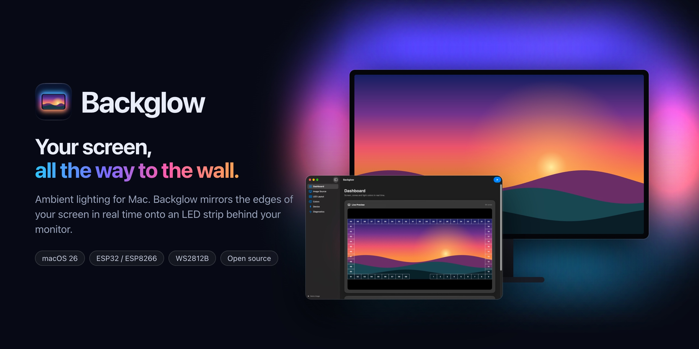

[](https://backglow.jandeboer.de)

# Backglow – Ambient Lighting for Mac

**[Download for macOS](https://github.com/Janldeboer/Backglow/releases/latest)** · [Website](https://backglow.jandeboer.de) · [Setup guide](https://backglow.jandeboer.de/en/docs/)

Backglow mirrors the edges of your Mac's screen onto an LED strip behind it. Version 3 is a native SwiftUI redesign of the earlier Ambilight for Mac experiments, previously published as *macOS Ambient Lighting*. It uses a sidebar and macOS Liquid Glass surfaces, while keeping the working LED controller protocol and perimeter layout from the older builds.

Website and docs: [backglow.jandeboer.de](https://backglow.jandeboer.de)

## Requirements

- macOS 14 or later on a Metal-capable Mac. Liquid Glass surfaces need macOS 26; macOS 14 and 15 show standard materials instead.
- Xcode 26 or later to build from source.
- Screen Recording permission for live capture.
- Optional serial LED controller running the included legacy sketch or ESP32/ESP8266 v3 firmware.

## Build and run

```sh
./scripts/build-app.sh
open dist/Backglow.app
```

The script creates an ad hoc signed native app in `dist/`. Open `Package.swift` in Xcode to work on the source. To run the pure core tests:

```sh
swift test --disable-sandbox
```

On the first capture, macOS may request Screen Recording access. Grant it in **System Settings → Privacy & Security → Screen Recording**, then restart the app if prompted.

## Signing and notarization

`build-app.sh` signs with the hardened runtime. It prefers a *Developer ID Application* certificate, falls back to *Apple Development*, and signs ad hoc on CI or with `SIGN_IDENTITY=-`. A notarized download is built like this:

```sh
./scripts/build-app.sh       # with Developer ID in the keychain
./scripts/notarize.sh        # notarizes and staples the app, then builds, notarizes and staples the DMG
```

On a `v3.*` tag, CI does the same once the repository secrets `DEVELOPER_ID_P12`, `DEVELOPER_ID_P12_PASSWORD`, `NOTARY_KEY_P8`, `NOTARY_KEY_ID` and `NOTARY_ISSUER_ID` exist, and publishes the release. Without them a tag only builds. `notarize.sh` reads its credentials from the keychain profile `backglow-notary` (create it once with `xcrun notarytool store-credentials backglow-notary`) or from an App Store Connect API key in `NOTARY_KEY`, `NOTARY_KEY_ID` and `NOTARY_ISSUER`.

## Languages

The app is localized in German (source language) and English, and follows the language set for it in System Settings. Strings live in String Catalogs under `AppBundle/Localization`; `build-app.sh` compiles them into the app bundle. After adding or changing user-facing text, run `./scripts/update-strings.sh` to add the new keys to `Localizable.xcstrings`, then translate them. To test a language without changing the system setting: `open dist/Backglow.app --args -AppleLanguages "(en)"`.

## How it works

1. ScreenCaptureKit captures one display in sRGB, excluding this app's windows. The capture resolution and target frame rate are adjustable.
2. The perimeter mapper selects LED zones using rows, columns, start offset, LED count, and direction. Optional black-bar detection adjusts the content bounds; a stabilizer ignores glitches under 0.25 s, applies a new border after 1 s and keeps it through dark scenes for 10 s.
3. A Metal compute shader averages the pixels in each zone on the GPU in linear light, through an sRGB texture view. If Metal setup or a dispatch fails, a full-pixel CPU reference path with the same result is used. Only one frame is in flight at a time.
4. Color temperature and the optional eight-corner LED calibration are applied in linear light. The colors are then encoded back to sRGB, and saturation, gamma, channel gains, brightness and the minimum backlight are applied to the small LED-color array.
5. A damped spring in BT.709 YUV smooths the colors on its own output clock, sized to the serial bandwidth and capped at 60 Hz. Its speed does not depend on the capture rate, and a luma rate limit softens hard cuts. An optional power limit scales bright frames down evenly, then an anti-flicker filter holds 8-bit values against sub-step noise.
6. The preview shows the captured image, numbered zones, their calculated colors, and a strip in serial output order.
7. ORSSerialPort writes the newest available frame on a dedicated queue. Older unsent frames are replaced instead of growing a backlog.

Linear-light averaging, the LED calibration, minimum backlight and power limit, the spring smoother, the anti-flicker filter and the temporal black-border logic follow [HyperHDR](https://github.com/awawa-dev/HyperHDR) (MIT, awawa-dev). They are reimplemented in Swift here.

The device menu only lists USB-backed serial callout ports. Virtual Bluetooth and system ports are hidden, and a selected port is checked again before opening. This is a guard against accidental connection, not proof that an arbitrary USB serial adapter is a microcontroller. A port is only opened when you choose it, or for a display and controller pair you remembered under **Automatik**.

## Menu bar, login and automatic connection

A menu bar item switches the lights on and off, picks the mode (screen or a single color), sets the color and the brightness, and connects the controller. When the main window is closed, Backglow keeps running in the menu bar without a Dock icon. **Bei der Anmeldung starten** registers the app as a login item through `SMAppService`; started at login, it opens no window.

Under **Automatik** you remember the selected display together with the connected controller. As soon as both are present, Backglow connects and switches the lights on in the chosen mode; when either disappears, the lights go off and the port is closed. The display is recognized by its EDID vendor, model and serial number. The controller must match its USB vendor and product ID plus its USB serial number, or, for adapters without one, the same port path, which follows the USB socket. With v3 firmware the chip ID is remembered as well, and no LED data, not even black, is sent before the controller has reported it. Switching off by hand keeps the pair off until it is unplugged once. The LEDs also go dark while the displays sleep and when Backglow quits.

In **single-color mode** every LED shows one color, without screen capture or Screen Recording permission. The color runs through the same spring smoother, color correction and power limit as the screen colors.

Settings are saved in `~/Library/Application Support/Backglow/settings.json`.
With v3 firmware, the app loads the controller's LED layout and color calibration
after an explicit connection. Temperature, the eight-corner LED calibration, minimum
backlight and power limit are stored only in the local settings for now, because the
v1 controller profile has a fixed layout. Edits stay local until **Aktuelle Einrichtung
speichern** writes and reads back the profile. Mac display selection and capture
settings remain local.

## LED controller

`Firmware/SerialLEDcontroller/SerialLEDcontroller.ino` is the original FastLED sketch, preserved for compatibility. Its defaults are **70 WS2812B LEDs**, **pin 2**, **GRB**, and **230400 baud**. Configure the number of physical LEDs and the matching baud rate in the app. Each frame uses the existing `led` + one-byte index + RGB bytes per LED, ending with `les` to display the frame. Changing these firmware defaults requires matching changes in the app's device settings.

The serial library is ORSSerialPort **2.1.0**, the latest upstream release checked for this rebuild. It is vendored at `Vendor/ORSSerialPort` so builds do not depend on GitHub access. Its MIT license is in that directory. The app's own license is GPL-3.0, as in the original repository.

The new ESP32/ESP8266 firmware is in [Firmware/BackglowController](Firmware/BackglowController/README.md).
It stores a versioned profile in ESP32 NVS or ESP8266 LittleFS and continues to
accept the `led`/`les` color stream. The legacy sketch does not store profiles.
Build and board setup are described in the firmware README. Guarded in-app
flashing remains planned in
[Controller-Onboarding.md](docs/Controller-Onboarding.md); the app does not flash devices.

## Code map

- `Sources/BackglowCore`: device-independent configuration, perimeter mapping, pixel analysis, color correction, and serial packet/profile encoding.
- `Sources/Backglow/ScreenCaptureEngine.swift`: ScreenCaptureKit lifecycle and frame delivery.
- `Sources/Backglow/GPUZoneReducer.swift` and `Shaders/ZoneAverage.metal`: GPU zone averaging.
- `Sources/Backglow/LightingModel.swift`: app state, settings, frame processing, and output coordination.
- `Sources/Backglow/BackglowApp.swift`: native sidebar and preview UI, app delegate and scenes.
- `Sources/Backglow/MenuBarPanel.swift` and `SolidColorPicker.swift`: menu bar control and single-color picker.
- `Sources/Backglow/LoginItem.swift`: open at login through `SMAppService`.
- `Sources/Backglow/DisplayDiscovery.swift`: display identity from EDID through Core Graphics.
- `Sources/BackglowCore/AutoConnect.swift`: matching remembered display and controller pairs.
- `Sources/Backglow/SerialDevice.swift`: ORSSerialPort adapter.
- `Sources/Backglow/USBSerialPortDiscovery.swift`: read-only USB serial discovery.

The previous history remains in Git. The complete older implementation is on `origin/main`; the later architecture experiments are available as `legacy/v2`, `origin/2.1`, `legacy/serial-fix`, and `legacy/2.2-pipeline` in this checkout. Version 3 is a fresh implementation rather than a continuation of the incomplete pipeline rebuild.

## Verification scope

The core tests cover LED order and offset, linear-light BGRA averaging, color calibration,
LED calibration, minimum backlight, power limit, loading older settings,
spring smoothing, anti-flicker, black-bar detection and stabilization, output rate,
the legacy packet, and the new profile protocol. A native
C++ harness checks the firmware's protocol and persistence logic. Both PlatformIO
firmware environments build. `swift scripts/check-metal.swift Sources/Backglow/Shaders/ZoneAverage.metal`
runs a real Metal dispatch with a known 2×2 test image and checks the sRGB-to-linear averaging. Live capture permissions,
serial transfer and persistent storage still require testing with real hardware.
